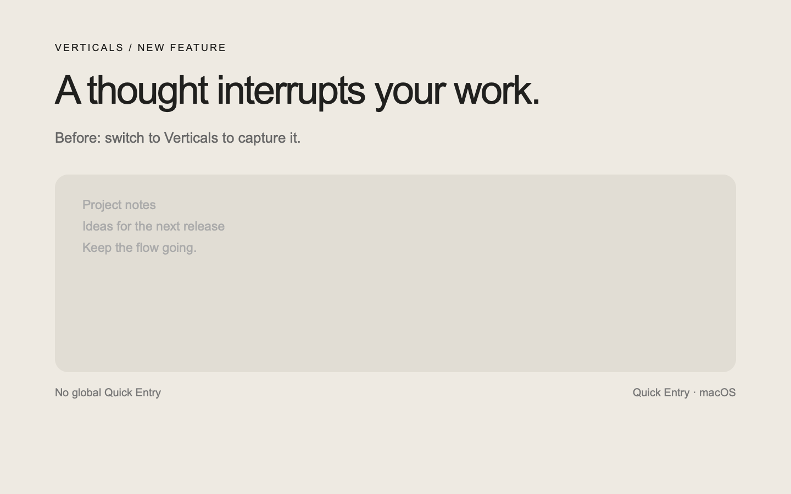
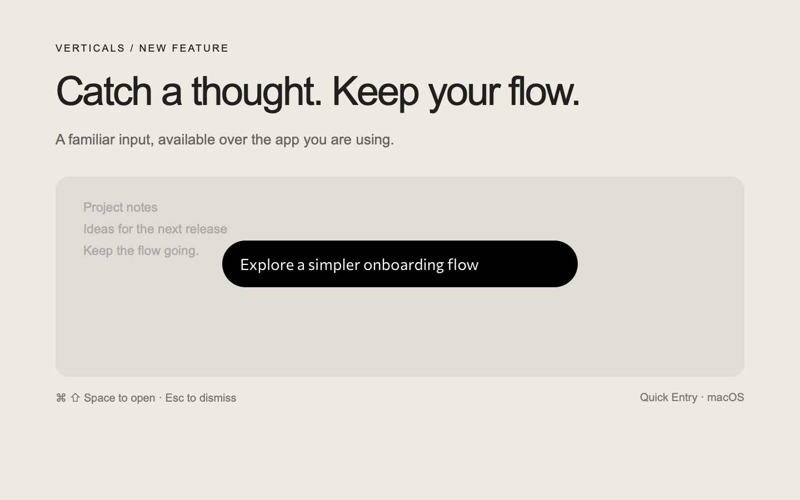
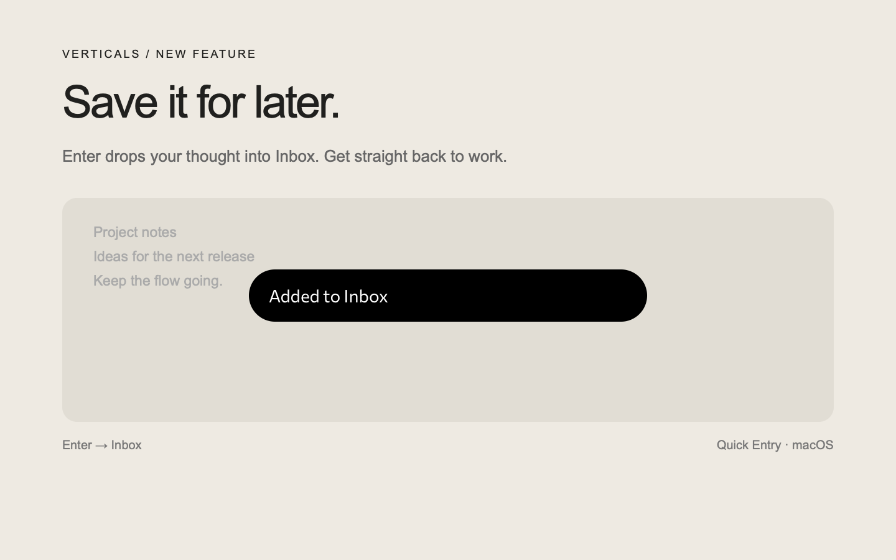
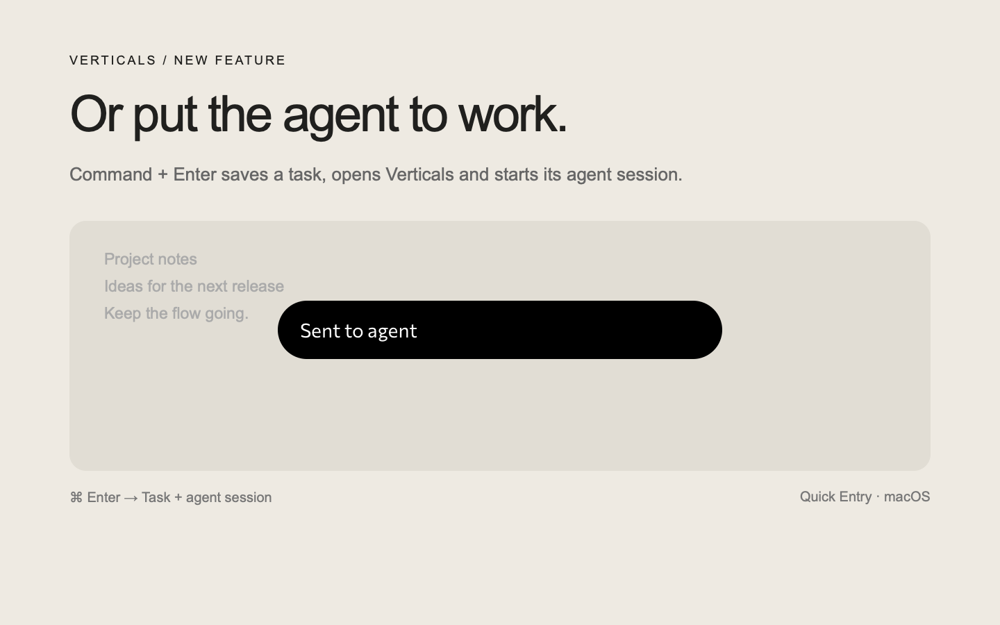

# Quick Entry preview

New macOS feature: Command+Shift+Space opens the app's input bubble above the current application. Enter saves to Inbox; Command+Enter saves a task, opens it and starts its agent session. Shortcut changes are available through the agent, with no settings UI.

The three promotional screenshots render the actual Quick Entry page over a staged, synthetic background. Success states are held for legibility; they are not screenshots of an agent finishing work. The before image illustrates the absence of a global capture field. These images explain the feature; native integration is checked separately by `tests/quick_entry/native_smoke.swift`.

The two short videos compare text feedback before and after the confirmation fade. The before clip disables the confirmation animation to reproduce the preceding implementation; the after clip uses the current page. The native bridge is stubbed and success is held for legibility. These clips show the text transition, not native panel dismissal or a backend transaction; native fade and reentry are measured by the smoke test.
